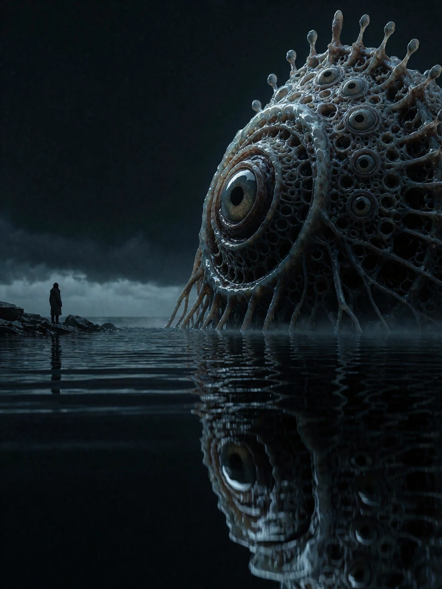

# Examples

Ten topics, prompted twice: first with only a file list as context, then with the entire skill. Each section below shows the two renders side by side, generic prompt on the left, skill prompt on the right; both prompts are published in the linked page.

## How these were generated

Both prompt sets come from DeepSeek v4.1 Flash, generated in two passes:

1. **File list only.** The model was given README.md and the list of the skill's files, without their contents and without any other details, and asked to generate ten prompts that might be relevant to the README contents and the file list.
2. **Full skill.** The same model was then given the full skill contents, including all reference files, and asked to generate prompts for the same ten topics, this time with domain knowledge.

The model saw no other details and no intermediate results.

## [Window Portrait](./window-portrait.md)

| Generic | Skill |
|:---:|:---:|
|  |  |

## [Product Hero](./product-hero.md)

| Generic | Skill |
|:---:|:---:|
|  |  |

## [Arabesque](./arabesque.md)

| Generic | Skill |
|:---:|:---:|
|  |  |

## [Goat Carry](./goat-carry.md)

| Generic | Skill |
|:---:|:---:|
|  |  |

## [Poster Text](./poster-text.md)

| Generic | Skill |
|:---:|:---:|
|  |  |

## [Film Noir](./film-noir.md)

| Generic | Skill |
|:---:|:---:|
|  |  |

## [Megastructure](./megastructure.md)

| Generic | Skill |
|:---:|:---:|
|  |  |

## [Kaiju](./kaiju.md)

| Generic | Skill |
|:---:|:---:|
|  |  |

## [Cosmic Horror](./cosmic-horror.md)

| Generic | Skill |
|:---:|:---:|
|  |  |

## [Boudoir](./boudoir.md)

| Generic | Skill |
|:---:|:---:|
|  |  |
