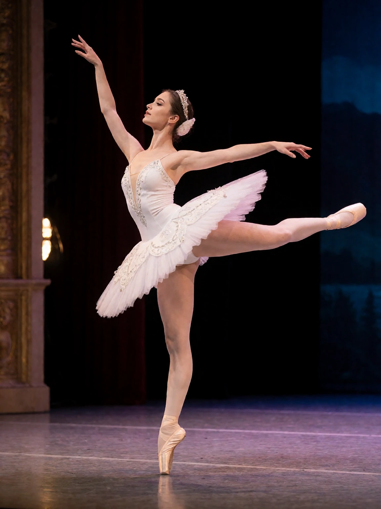
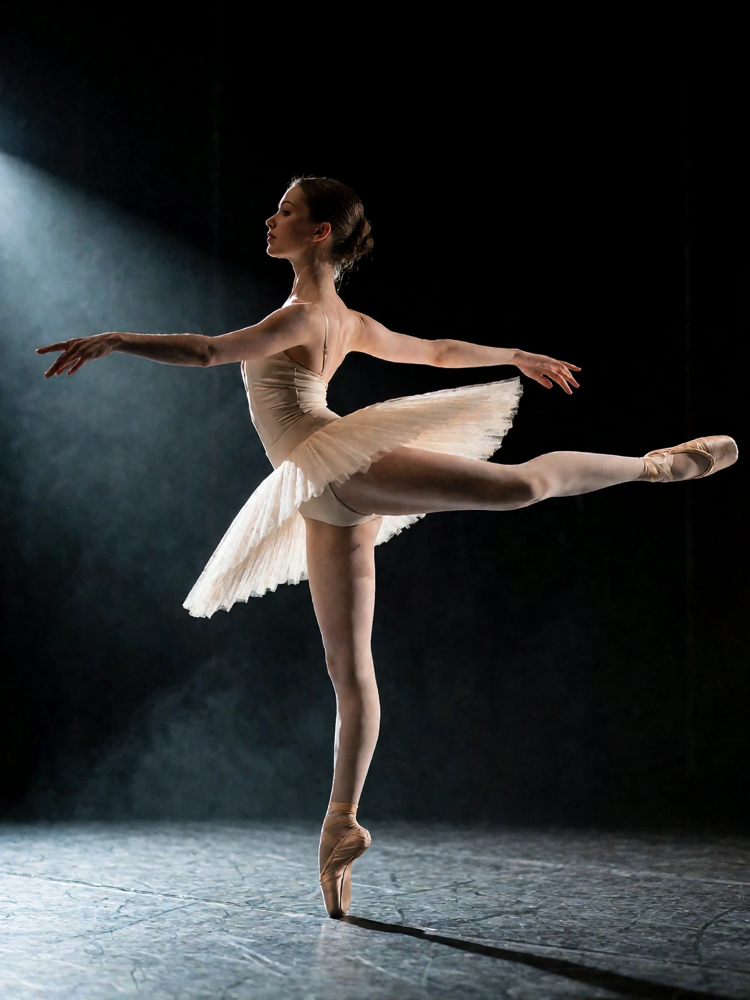

# Arabesque example

## Generic AI-assisted prompt

```
An elegant ballerina performing a perfect arabesque en pointe on a theater stage, white tutu, dramatic stage lighting, dark background, professional dance photography, graceful, cinematic, ultra detailed, 8k, masterpiece, best quality.
```

<details>

<summary>Result</summary>



</details>

## AI-assisted prompt using the skill

```
A professional dance photograph of a ballerina holding a grand arabesque en pointe on a dark theatre stage, captured in full side profile, her line reading from the supporting foot through the extended back leg to the fingertips. She wears a pale ivory classical tutu with a matte satin bodice. A single hard side light from stage left carves her silhouette out of the near-black stage; a cool rim light traces the extended arm and the arch of the supporting foot, thin haze hanging over the boards. Shot on 85mm at stage level with the full figure sharp, 3:4 vertical crop giving clean air above the extended leg, fine film grain, quiet dramatic mood.

Pose: Ballet Arabesque
leg_position: The supporting leg is fully extended en pointe, foot vertical in the shoe; the working leg extends straight behind the body at hip height, knee locked, foot pointed.
arm_position: The front arm reaches forward at chest height with a soft elbow curve; the back arm extends behind at shoulder height, both held in a long classical line.
hand_position: Fingers elongated and relaxed with a gentle downward curve, wrists soft.
torso_orientation: Spine elongated and slightly inclined forward, chest lifted, shoulders level and pulled down.
head_orientation: Head turned to gaze past the front arm toward the horizon, chin level and serene.
weight_distribution: Nearly all of the weight rests on the supporting foot en pointe, the extended leg carrying none.
center_of_gravity: Balanced directly over the supporting foot, the extended back leg acting as counterweight.
muscle_tension: High in the supporting leg, ankle, and core; calm and controlled everywhere else.
movement_quality: Suspended, elegant, effortless.
balance: Dynamic, held at the top of the rise.
silhouette: A long horizontal line through the extended leg and arms balanced on a single vertical column.
```

<details>

<summary>Result</summary>



</details>
