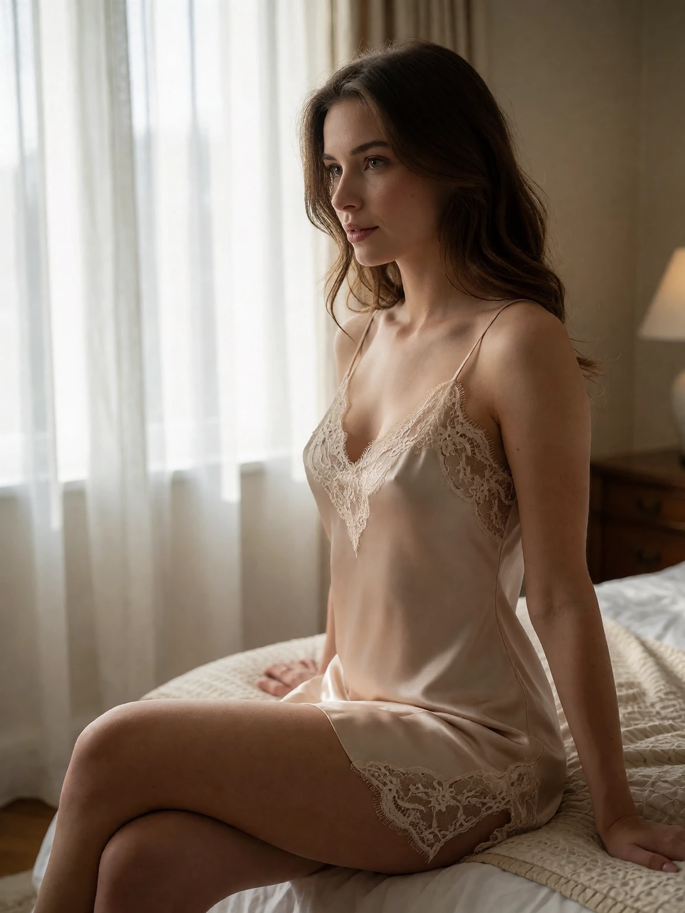
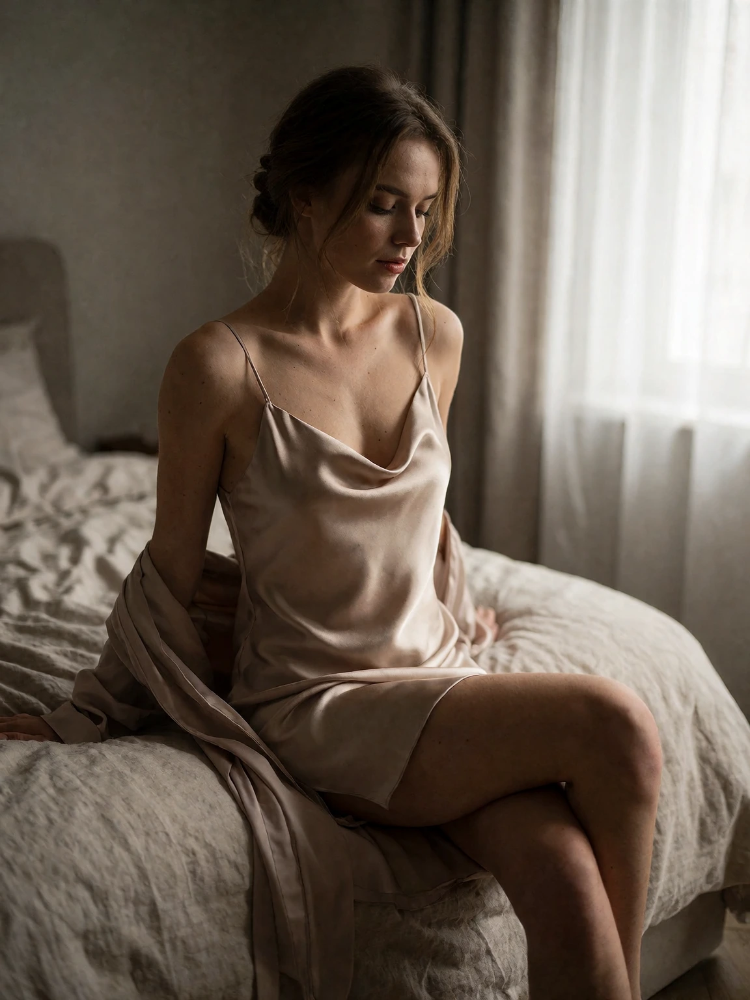

# Boudoir example

## Generic AI-assisted prompt

```
Boudoir photography of a woman in an elegant silk slip sitting on the edge of a bed, soft morning light through sheer white curtains, tasteful and elegant, intimate atmosphere, shallow depth of field, photorealistic, ultra detailed, 8k, best quality.
```

<details>

<summary>Result</summary>



</details>

## AI-assisted prompt using the skill

```
A boudoir photograph of a woman sitting on the edge of an unmade bed in a softly lit bedroom, three-quarter body in a 3:4 vertical crop. She wears a champagne silk slip catching a soft sheen along its folds, one knee drawn up, hair loosely pinned, her gaze lowered to the side; a thin robe has slipped off one shoulder onto the mattress. Window light diffuses through sheer white curtains from camera right, wrapping her shoulders and laying gentle shadows across the linen sheets; the room behind settles into quiet warm greys. Shot on 50mm f/2 at seated eye level, shallow depth of field, natural skin texture with visible pores, subtle film grain, the linen weave and the fluid highlights of the silk both readable. Intimate, elegant morning mood.
```

<details>

<summary>Result</summary>



</details>
