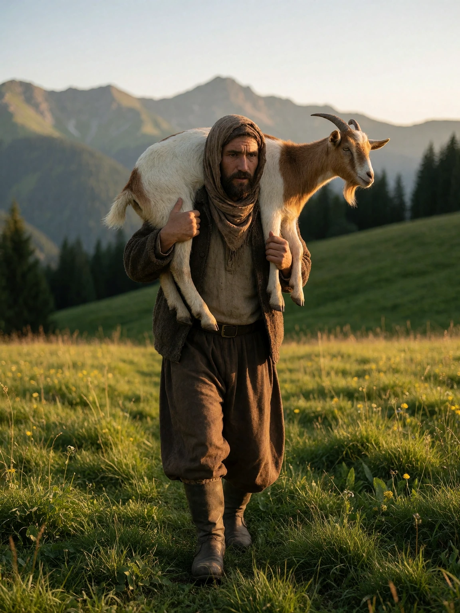
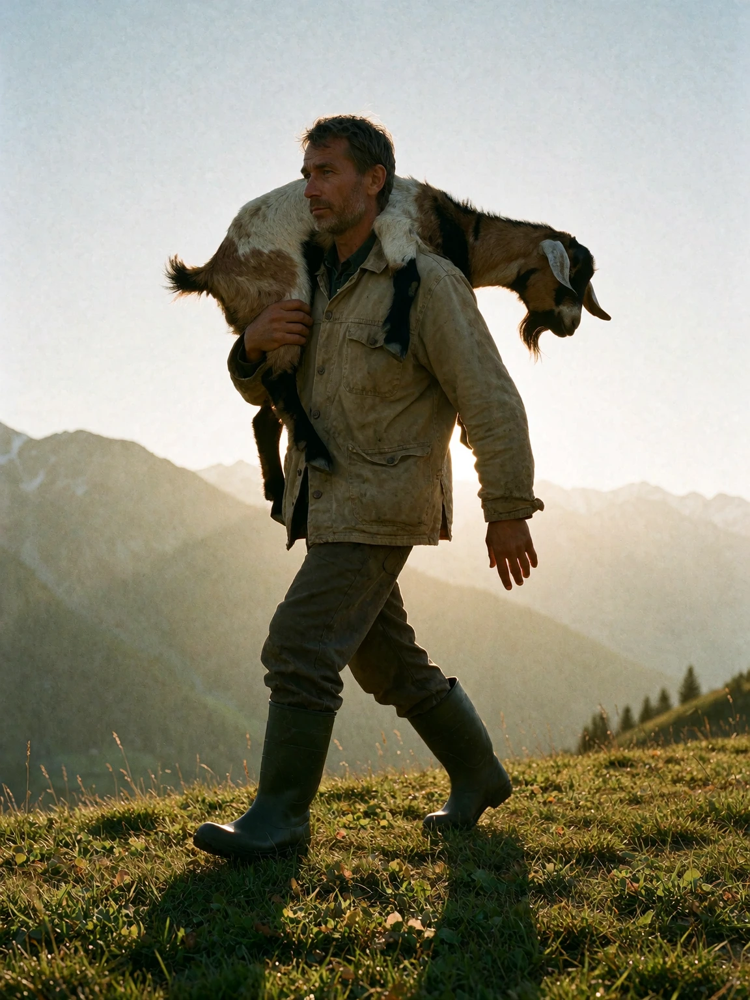

# Goat carry example

## Generic AI-assisted prompt

```
A shepherd carrying a goat over his shoulder, walking through a green mountain meadow at golden hour, rural documentary photography, natural light, mountains in the background, ultra detailed, 8k, best quality.
```

<details>

<summary>Result</summary>



</details>

## AI-assisted prompt using the skill

```
A documentary photograph of a shepherd carrying a goat over one shoulder along a grass ridge in a mountain meadow at golden hour, full body in frame, 3:4 vertical crop. He wears a worn canvas jacket and rubber boots; the goat rides draped across his shoulders with its head hanging calmly behind his back. The camera holds at eye level, 35mm environmental, a low raking sun from camera right stretching his shadow across the grass, warm rim light through the goat's ear fur and the shepherd's weathered face, thin haze lying over the valley beyond. Film grain, natural colour, unhurried rural mood.

Pose: Carrying a Goat Over Shoulder
leg_position: A stable walking stance, lead foot planted on the uneven grass and the trailing leg mid-push, knees soft.
arm_position: One arm supports the goat over the shoulder while the opposite arm balances naturally.
hand_position: Firm grip securing the goat's forelegs, the opposite hand relaxed and open.
torso_orientation: A slight lean opposite the carried load, shoulders squared to the path ahead.
head_orientation: Neutral with a forward gaze.
weight_distribution: Shifted slightly toward the supporting side.
center_of_gravity: Offset toward the load.
muscle_tension: Moderate to high in the shoulders, back, and legs.
movement_quality: Strong, deliberate, and efficient.
balance: Stable despite the asymmetrical load.
silhouette: Asymmetrical silhouette emphasizing the elevated goat.
```

<details>

<summary>Result</summary>



</details>
