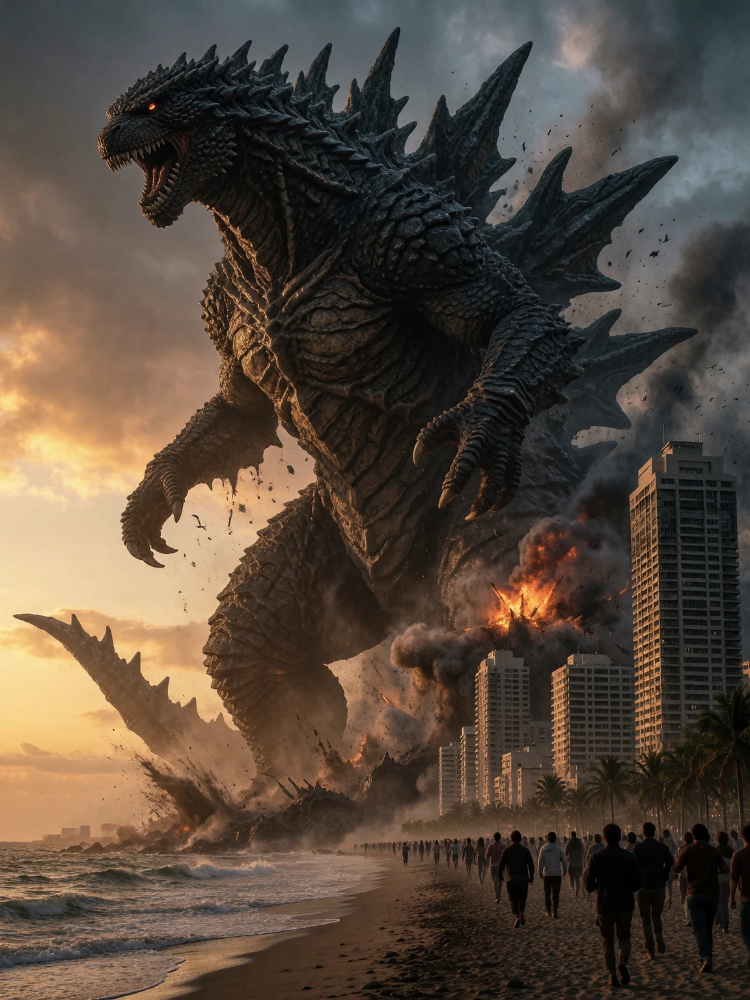
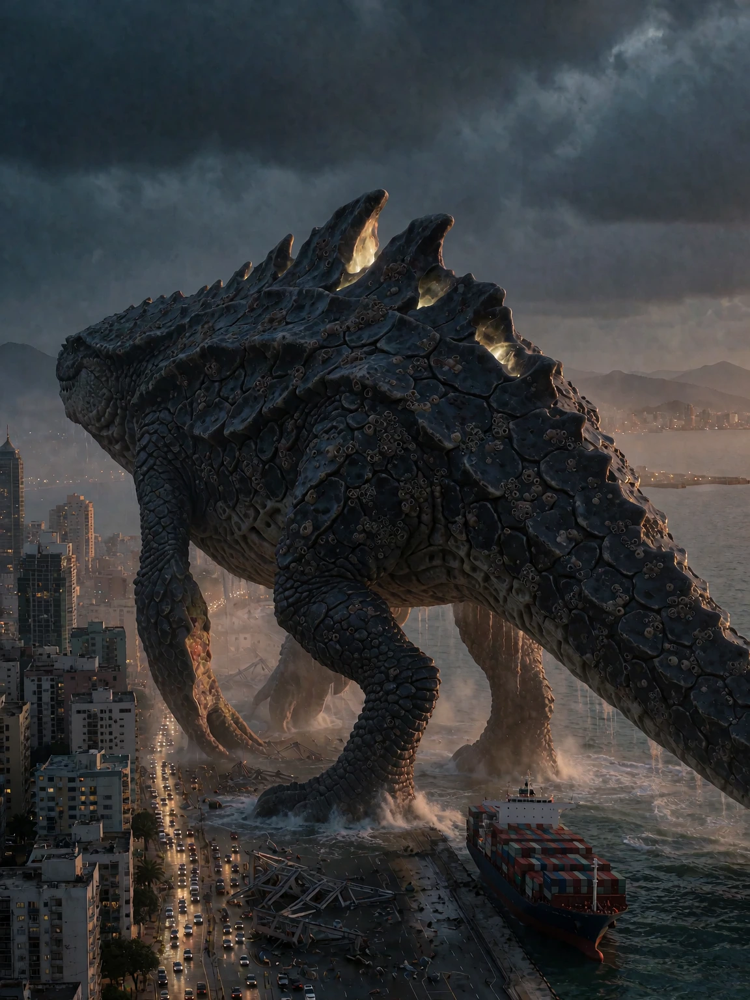

# Kaiju example

## Generic AI-assisted prompt

```
Epic shot of a colossal kaiju monster destroying a coastal city at dusk, towering over skyscrapers, dramatic lighting, destruction, fleeing crowds, cinematic, hyper detailed, 8k, masterpiece, best quality.
```

<details>

<summary>Result</summary>



</details>

## AI-assisted prompt using the skill

```
A photorealistic cinematic photograph of a colossal fictional leviathan wading through a coastal city at dusk, standing 900 meters tall above the harbour skyline. The creature has a mountainous bipedal body, a ridged carapace of overlapping obsidian scales crusted with barnacles, and a dorsal ridge split by glowing fissures; its surface reads as a dense biological landscape of millions of hand-sized plates and pores. One clawed foot rests in the flooded streets past the seawall, structural debris and spray scattered around it, the tail disappearing out of the right edge of the frame; the upper third of the image stays open as a dark storm sky. A grid of headlights threads the streets at its feet, less than 1% of the frame on the same distant depth plane as the far shoreline, with a container ship lying tilted at the quay beside its ankle. Shot from an extreme far distance with a 400mm super telephoto at a low angle, dusk light rimming the creature's silhouette in cold amber, fog and dust haze separating the layers of the city. 3:4 vertical crop, monumental disaster-reportage mood.
```

<details>

<summary>Result</summary>



</details>
