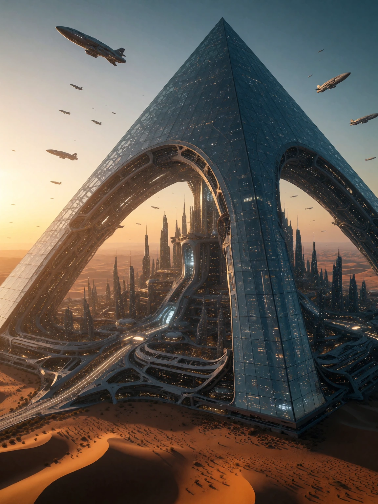
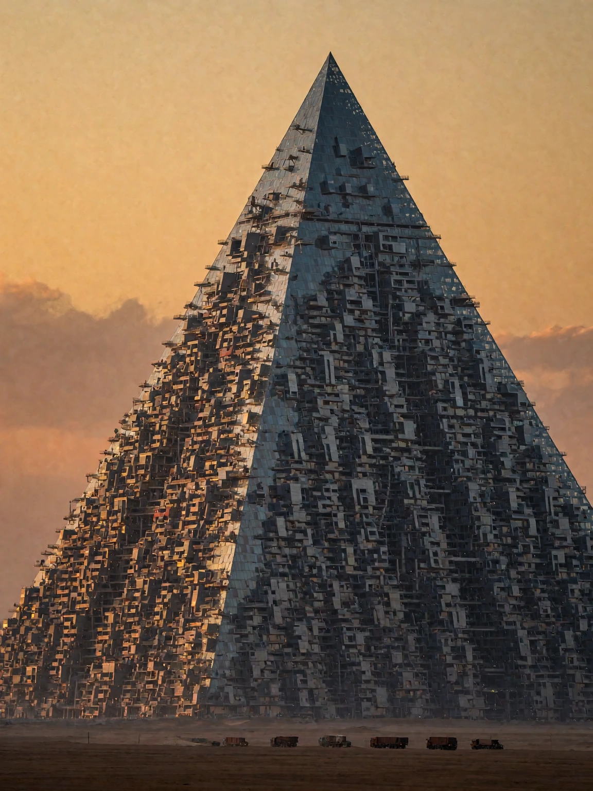

# Megastructure example

## Generic AI-assisted prompt

```
Epic sci-fi megastructure, an enormous futuristic arcology city built inside a colossal glass pyramid in the desert at sunset, tiny airships circling above, epic scale, cinematic concept art, highly detailed, 8k, masterpiece, best quality.
```

<details>

<summary>Result</summary>



</details>

## AI-assisted prompt using the skill

```
A photorealistic cinematic photograph of a colossal arcology rising from the desert, a glass-and-steel pyramid 2,800 meters tall, its full height revealed from foundation to summit. The structure occupies about two thirds of the frame, its base sprawling beyond both side edges while the horizontal city grid extends endlessly out of frame. Captured from an extreme far distance with a 600mm super telephoto at a level angle, its surface resolving into a dense honeycomb of human-scale windows, balconies, ventilation stacks, and maintenance catwalks, a fine glittering grid where the sunset catches the glass. The upper third of the frame stays open as amber sunset sky, drifting dust haze separating the pyramid from the horizon. At the extreme distant base, on the same far depth plane, a convoy of heavy trucks occupies less than 0.1% of the frame as tiny dark marks. Warm amber light rakes the western face while the eastern face falls into deep shadow. Documentary mood, 3:4 vertical crop.
```

<details>

<summary>Result</summary>



</details>
