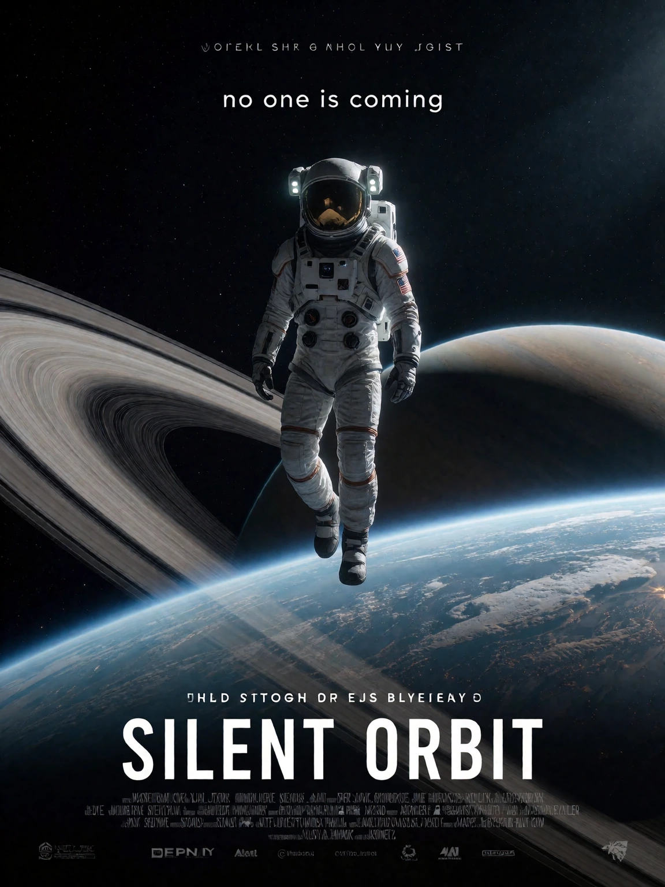
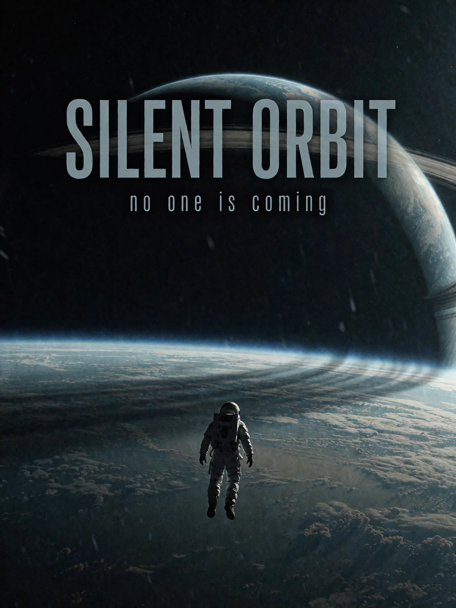

# Poster text example

## Generic AI-assisted prompt

```
Movie poster for a science fiction film titled SILENT ORBIT, a lone astronaut floating above a ringed planet, dark space background, cinematic dramatic lighting, blockbuster poster style, tagline text "no one is coming", ultra detailed, 8k, best quality.
```

<details>

<summary>Result</summary>



</details>

## AI-assisted prompt using the skill

```
A cinematic science fiction film poster in a vertical 3:4 crop. A lone astronaut floats small in the lower centre of the frame, seen from behind, above the curve of a ringed planet that fills the middle distance; deep darkness holds the upper half of the canvas. A pale sun glints off the helmet and along the planet's terminator line, cold blue and graphite palette, subtle film grain across the whole poster. The only large readable text is the title "SILENT ORBIT", set in condensed sans-serif capitals across the upper third, with the small tagline "no one is coming" in thin lowercase letters beneath it; both lines sit integrated into the dark negative space, the planet's ring crossing slightly over the title. Poster art register, generous empty darkness around the text block, quiet monumental dread.
```

<details>

<summary>Result</summary>



</details>
