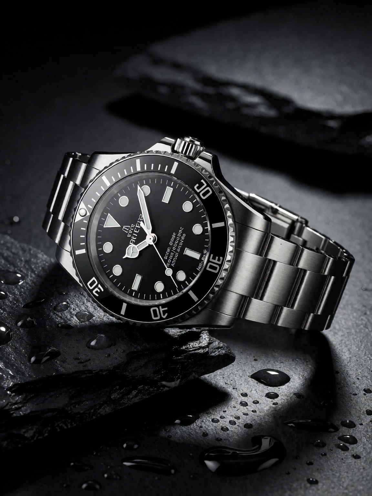
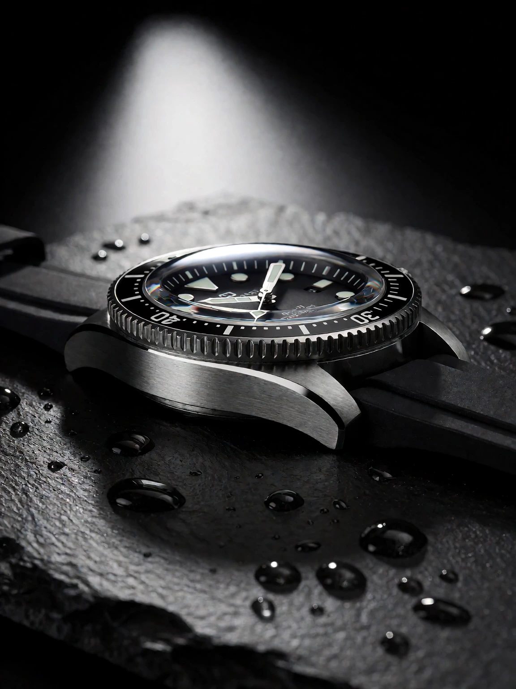

# Product hero example

## Generic AI-assisted prompt

```
Professional product photography of a luxury stainless steel dive watch resting on wet dark slate, dramatic studio lighting, water droplets on brushed metal, macro details, deep shadows, commercial advertising shot, ultra sharp focus, 8k, ultra detailed, best quality.
```

<details>

<summary>Result</summary>



</details>

## AI-assisted prompt using the skill

```
A high-end commercial product photograph of a stainless-steel dive watch resting on wet black slate, framed tight in a 3:4 vertical crop. The case is brushed steel with a polished bezel edge, the dial sits under a slightly domed sapphire crystal, and a black rubber strap curls naturally to the right of the case. Water beads scatter across the slate and stand raised on the brushed metal, each carrying a tiny specular highlight. One large softbox above and slightly behind camera left sculpts a long highlight down the case flank, deep shadow pools under the crown, and a faint rim glint traces the bezel while the background falls into a near-black gradient. A macro lens at f/8 keeps the dial sharp edge to edge, micro-reflections of the light source visible in the crystal, faint scuffs on the slate keeping the surface physical. Polished quiet-luxury mood.
```

<details>

<summary>Result</summary>



</details>
