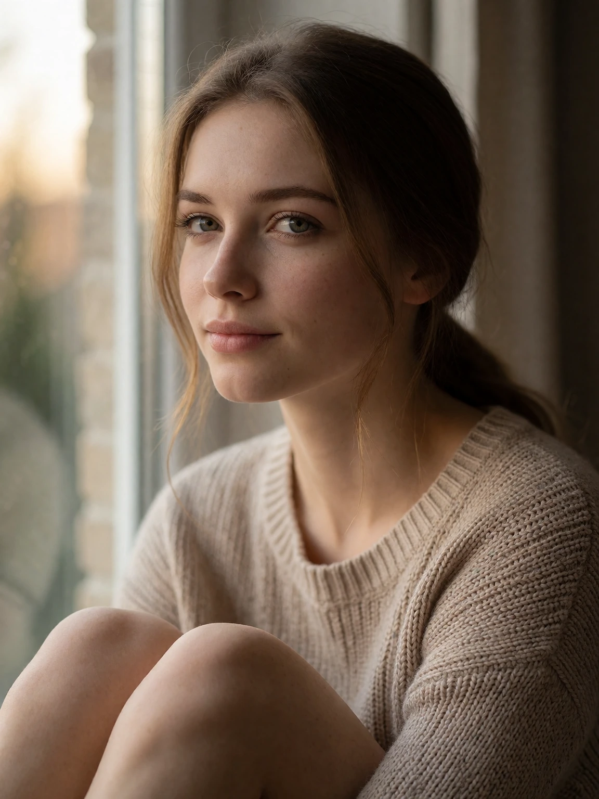
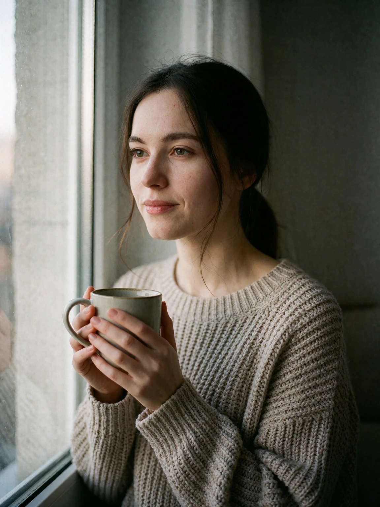

# Window portrait example

## Generic AI-assisted prompt

```
A hyperrealistic portrait of a young woman sitting by a large window, soft morning light on her face, gentle smile, cozy knit sweater, natural skin texture, shallow depth of field, shot on 85mm lens, cinematic warm tones, ultra detailed, 8k, masterpiece, best quality.
```

<details>

<summary>Result</summary>



</details>

## AI-assisted prompt using the skill

```
A calm editorial portrait photograph of a young woman seated beside a large window, three-quarter shot, her face turned slightly toward the glass. She wears an oatmeal chunky-knit sweater, her dark hair loosely tied back and a warm mug held in both hands near her chest; the quiet apartment interior behind her falls softly out of focus in muted greys. Soft diffused morning light enters from camera left through sheer curtains, wrapping her face in even illumination and laying a slow gradient across the wall. Shot on 85mm f/2 at eye level with shallow depth of field, Kodak Portra 400 colour palette, natural skin texture with visible pores, catchlights in the eyes, a single loose strand of hair crossing her cheek, the wool weave of the knit readable in the light. A gentle closed-mouth smile. 3:4 vertical crop, calm and candid mood.
```

<details>

<summary>Result</summary>



</details>
